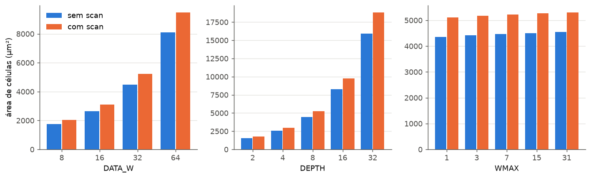
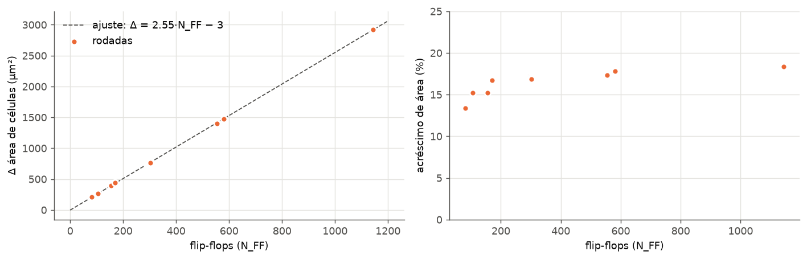
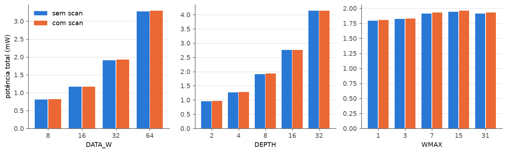
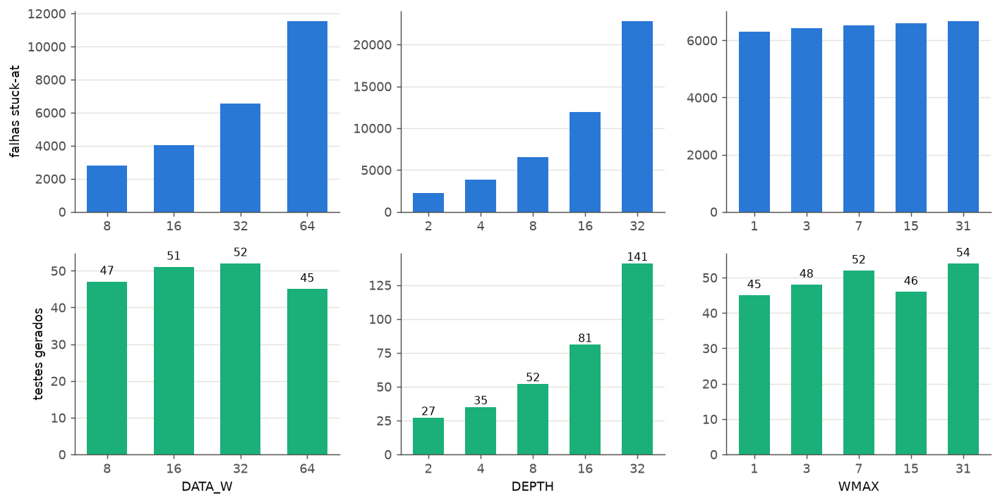
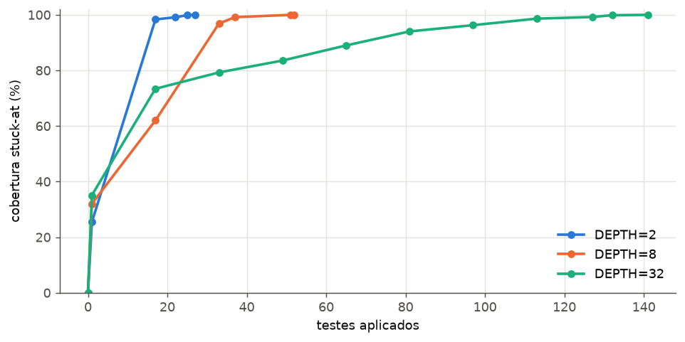
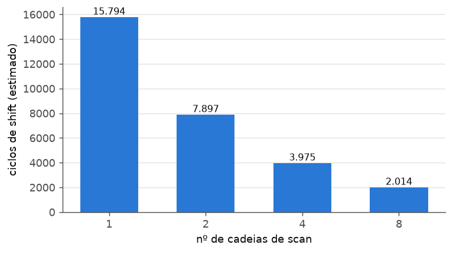

# Relatório T2: scan chain e ATPG no stream_merge

98G10-04 Confiabilidade e Segurança de Hardware, PUCRS, 2026/2

Bruno Becker Silva, Gabriel Eduardo Decian, Lukas Ely, Matheus Robin

## 1. Objetivo

Reproduzir o tutorial de inserção de scan chain e geração de padrões de teste com Genus e Modus e adaptar o fluxo para o módulo `stream_merge` (desafio EnSilica do T1). Em seguida, variar os parâmetros do módulo (`DATA_W`, `DEPTH`, `WMAX`) e medir:

- o custo da inserção dos registradores de scan em área, e também em potência;
- a cobertura de falhas stuck-at obtida pelo ATPG e o número de padrões necessário;
- se os padrões gerados passam na simulação da netlist com scan.

## 2. Ambiente e fluxo

| Item | Versão / valor |
|---|---|
| Síntese e DFT | Cadence Genus 21.12 |
| ATPG | Cadence Modus 21.10 |
| Simulação dos padrões | Cadence Xcelium (xrun) 23.03 |
| Biblioteca | STM 65 nm, CORE65GPSVT e CLOCK65GPSVT, 1,0 V, 25 °C |
| Clock | 4 ns (250 MHz) |
| Estilo de scan | muxed scan, pinos `chip_scan_se` (shift enable) e `chip_scan_tm` (test mode) |
| Modelo de falhas | stuck-at estático |

O fluxo de cada configuração é:

1. **Genus, síntese:** `syn_generic`, `syn_map`, `syn_opt` e relatórios de área, portas e potência **antes** do scan.
2. **Genus, DFT:** `replace_scan` troca cada flip-flop por um scan flip-flop. `connect_scan_chains` liga os flip-flops em cadeia. Depois vêm uma síntese incremental, os relatórios **depois** do scan e o `write_dft_atpg`, que exporta o projeto para o Modus.
3. **Modus:** `build_model`, `build_testmode` (FULLSCAN), `verify_test_structures`, `build_faultmodel` e `create_logic_tests` (ATPG); os vetores são gravados em Verilog.
4. **Xcelium:** simula os vetores contra a netlist com scan e compara cada saída com o valor esperado pelo Modus.

O clock de 4 ns é folgado de propósito. Com um período apertado, o Genus aumentaria células para fechar timing nas configurações maiores e a comparação de área ficaria contaminada por esse efeito.

## 3. Tutorial: busca_padrao

O tutorial (`testa_padrao_scan/`) foi executado com os scripts fornecidos, sem alteração. Os logs estão em `testa_padrao_scan/results/`.

| Métrica | Valor |
|---|---|
| Flip-flops em scan | 116 |
| Cadeias | 2: 16 FFs na borda de descida e 100 na de subida |
| Falhas stuck-at | 6.885 (1 redundante, 1 não testada) |
| Cobertura (%TCov) | 99,97 % |
| Testes gerados | 410 (1 de scan + 409 de lógica) |
| Simulação | 410/410 aprovados, 52.048 comparações, 0 miscompares |

O Genus criou duas cadeias porque o módulo tem flip-flops sensíveis às duas bordas do clock e a opção `dft_mix_clock_edges_in_scan_chains` está desligada: flip-flops de bordas diferentes não podem ficar na mesma cadeia.

## 4. Adaptação para o stream_merge

Arquivos em `stream_merge/`:

| Arquivo | Função |
|---|---|
| `rtl/stream_merge.sv` | módulo do enunciado, sem alterações |
| `synthesis/constraint/stream_merge.sdc` | clock `clk` de 4 ns, atrasos de entrada/saída e cargas |
| `synthesis/constraint/load.tcl` | bibliotecas STM 65 nm (as mesmas do tutorial) |
| `synthesis/run_genus.tcl` | síntese parametrizada; recebe `DATA_W`, `DEPTH`, `WMAX`, `NCHAINS` por variável de ambiente |
| `synthesis/dft_setup.tcl` | inserção de scan, adaptada do tutorial |
| `scripts/run_one.sh` | executa Genus → Modus → Xcelium para uma configuração |
| `scripts/sweep.sh` | varredura completa |
| `scripts/collect.py` | extrai área, potência, cobertura, testes e resultado da simulação para CSV |
| `scripts/plot.py` | gera os gráficos deste relatório |

Diferenças em relação ao tutorial:

- **Linguagem:** o módulo é SystemVerilog, então a leitura usa `read_hdl -sv`.
- **Parâmetros:** são passados por `elaborate stream_merge -parameters {...}`. Com `hdl_parameter_naming_style ""`, o design mantém o nome `stream_merge` em todas as configurações.
- **Reset síncrono:** o `rst_n` do stream_merge é síncrono, diferente do tutorial, onde o reset é assíncrono e recebe `false_path`. Aqui ele é lógica comum: segue no timing e também é testado pelo ATPG.
- **Número de cadeias configurável:** usa o atributo `dft_min_number_of_scan_chains`.

### Número de flip-flops em função dos parâmetros

Pelo RTL, os registradores são:

| Registrador | Bits |
|---|---|
| FIFO: `mem_data`, `mem_src`, `mem_sop`, `mem_eop` | `DEPTH × (DATA_W + 3)` |
| Ponteiros `wr_ptr`, `rd_ptr` | `2 × clog2(DEPTH)` |
| Ocupação `occ` | `clog2(DEPTH+1)` |
| Créditos `credit0`, `credit1` | `2 × clog2(WMAX+1)` |
| `locked`, `lock_src` | 2 |

Para a configuração default (32, 8, 7), isso dá 280 + 6 + 4 + 6 + 2 = **298 flip-flops**, exatamente o número reportado pelo Genus e o comprimento da cadeia. A FIFO responde por 94 % dos registradores, então já era esperado que `DATA_W` e `DEPTH` dominassem o custo do scan e que `WMAX` quase não influenciasse.

## 5. Metodologia da varredura

Um parâmetro varia por vez e os outros ficam no default (`DATA_W=32`, `DEPTH=8`, `WMAX=7`), para isolar o efeito de cada um:

| Parâmetro | Valores |
|---|---|
| `DATA_W` | 8, 16, 32, 64 |
| `DEPTH` | 2, 4, 8, 16, 32 |
| `WMAX` | 1, 3, 7, 15, 31 |
| Nº de cadeias (no default) | 1, 2, 4, 8 |

São 15 configurações no total. Para reproduzir, a partir da raiz do repositório e com Genus, Modus e Xcelium no `PATH`:

```bash
SIM=1 stream_merge/scripts/sweep.sh
```

Uma configuração isolada:

```bash
SIM=1 stream_merge/scripts/run_one.sh 32 8 7
```

O resultado consolidado fica em `stream_merge/results/results.csv` e os relatórios de cada rodada em `stream_merge/results/reports/<configuração>/`.

## 6. Resultados de área e potência

### 6.1 Área



| DATA_W | DEPTH | WMAX | FFs | Área sem scan (µm²) | Área com scan (µm²) | Δ área | Área seq. sem → com (µm²) | Potência sem → com (mW) |
|---:|---:|---:|---:|---:|---:|---:|---:|---:|
| 8 | 8 | 7 | 106 | 1.764,9 | 2.033,2 | +15,2% | 1.058 → 1.322 | 0,809 → 0,816 |
| 16 | 8 | 7 | 170 | 2.651,0 | 3.095,0 | +16,8% | 1.723 → 2.154 | 1,163 → 1,170 |
| 32 | 8 | 7 | 298 | 4.468,9 | 5.225,5 | +16,9% | 3.054 → 3.818 | 1,910 → 1,927 |
| 64 | 8 | 7 | 554 | 8.090,2 | 9.494,2 | +17,4% | 5.717 → 7.146 | 3,277 → 3,299 |
| 32 | 2 | 7 | 82 | 1.538,7 | 1.744,6 | +13,4% | 824 → 1.029 | 0,957 → 0,971 |
| 32 | 4 | 7 | 155 | 2.570,4 | 2.961,4 | +15,2% | 1.577 → 1.968 | 1,270 → 1,286 |
| 32 | 16 | 7 | 581 | 8.274,2 | 9.751,0 | +17,9% | 5.990 → 7.487 | 2,757 → 2,766 |
| 32 | 32 | 7 | 1144 | 15.928,6 | 18.852,1 | +18,4% | 11.839 → 14.797 | 4,147 → 4,141 |
| 32 | 8 | 1 | 294 | 4.356,0 | 5.104,8 | +17,2% | 3.023 → 3.778 | 1,796 → 1,804 |
| 32 | 8 | 3 | 296 | 4.415,3 | 5.168,3 | +17,1% | 3.039 → 3.798 | 1,821 → 1,831 |
| 32 | 8 | 15 | 300 | 4.503,2 | 5.266,6 | +16,9% | 3.070 → 3.838 | 1,942 → 1,963 |
| 32 | 8 | 31 | 302 | 4.545,3 | 5.310,8 | +16,8% | 3.086 → 3.857 | 1,913 → 1,930 |

*Área de células (cell area) do `report_area`; área sequencial e potência do `report_gates` e do `report_power` (modelo de atividade padrão do Genus).*

O `replace_scan` não adiciona flip-flops: o número de células praticamente não muda (589 → 590 no default). Ele troca cada flip-flop por uma célula de scan, que já tem o multiplexador D/SI embutido. Na configuração default, a área sequencial passa de 10,25 para 12,81 µm² por flip-flop (+25 %), enquanto a área combinacional fica quase igual (1.414 → 1.408 µm²). O custo do scan está, portanto, praticamente todo nos registradores.

### 6.2 Curva de inserção de registradores



Juntando todas as configurações, o acréscimo de área de células em função do número de flip-flops segue uma reta:

**Δ área ≈ 2,55 µm² × N_FF** (intercepto de −2,7 µm², praticamente zero)

Cada flip-flop custa cerca de 2,55 µm² a mais quando vira scan, e não há custo fixo relevante. A consequência prática é que o custo do scan pode ser estimado já no RTL, só contando registradores.

O acréscimo **percentual**, por outro lado, não é constante: vai de 13,4 % (`DEPTH=2`, 82 FFs) até 18,4 % (`DEPTH=32`, 1144 FFs). Em circuitos pequenos, a lógica combinacional fixa (árbitro, flags, comparadores) é uma fração maior da área e dilui o custo. Conforme o circuito fica dominado por registradores, o percentual tende ao custo do próprio scan flip-flop, que é de cerca de 25 % sobre a área sequencial.

Por parâmetro:

- **`DATA_W`:** cada bit acrescenta `DEPTH = 8` flip-flops. Área e custo do scan crescem linearmente (+15,2 % a +17,4 %).
- **`DEPTH`:** cada posição acrescenta `DATA_W + 3 = 35` flip-flops. É o parâmetro com maior alcance (82 a 1144 FFs).
- **`WMAX`:** só muda a largura dos créditos (`clog2(WMAX+1)` bits cada). De 1 a 31 são apenas +8 flip-flops (294 → 302), e o acréscimo fica entre 16,8 % e 17,2 %.

### 6.3 Potência



A potência total (relatório padrão do Genus, sem vetores de simulação) variou menos de 1,5 % com o scan em todas as configurações. No modo funcional, `SE = 0` e a cadeia fica parada: os multiplexadores de scan acrescentam carga e leakage (o leakage sobe cerca de 18 %), mas a potência dinâmica, que domina o total, quase não muda. Essa análise não cobre a potência **durante o teste**: no shift, todos os flip-flops chaveiam a cada ciclo, e ela seria bem maior.

## 7. Exploração do espaço de teste (cobertura)

### 7.1 Cobertura por configuração

| DATA_W | DEPTH | WMAX | FFs | Falhas | Testadas | Redund. | Não test. | %TCov | %ATCov | Testes | Testes p/ ≥99% ¹ | Simulação |
|---:|---:|---:|---:|---:|---:|---:|---:|---:|---:|---:|---:|---|
| 8 | 8 | 7 | 106 | 2.806 | 2.806 | 0 | 0 | 100,00 | 100,00 | 47 | 38 | 47/47, 0 miscomp. |
| 16 | 8 | 7 | 170 | 4.020 | 4.020 | 0 | 0 | 100,00 | 100,00 | 51 | 51 | 51/51, 0 miscomp. |
| 32 | 8 | 7 | 298 | 6.534 | 6.534 | 0 | 0 | 100,00 | 100,00 | 52 | 37 | 52/52, 0 miscomp. |
| 64 | 8 | 7 | 554 | 11.558 | 11.558 | 0 | 0 | 100,00 | 100,00 | 45 | 35 | 45/45, 0 miscomp. |
| 32 | 2 | 7 | 82 | 2.280 | 2.280 | 0 | 0 | 100,00 | 100,00 | 27 | 22 | 27/27, 0 miscomp. |
| 32 | 4 | 7 | 155 | 3.852 | 3.852 | 0 | 0 | 100,00 | 100,00 | 35 | 32 | 35/35, 0 miscomp. |
| 32 | 16 | 7 | 581 | 11.960 | 11.960 | 0 | 0 | 100,00 | 100,00 | 81 | 69 | 81/81, 0 miscomp. |
| 32 | 32 | 7 | 1144 | 22.836 | 22.836 | 0 | 0 | 100,00 | 100,00 | 141 | 127 | 141/141, 0 miscomp. |
| 32 | 8 | 1 | 294 | 6.312 | 6.312 | 0 | 0 | 100,00 | 100,00 | 45 | 39 | 45/45, 0 miscomp. |
| 32 | 8 | 3 | 296 | 6.418 | 6.416 | 2 | 0 | 99,97 | 100,00 | 48 | 38 | 48/48, 0 miscomp. |
| 32 | 8 | 15 | 300 | 6.596 | 6.596 | 0 | 0 | 100,00 | 100,00 | 46 | 41 | 46/46, 0 miscomp. |
| 32 | 8 | 31 | 302 | 6.686 | 6.686 | 0 | 0 | 100,00 | 100,00 | 54 | 53 | 54/54, 0 miscomp. |

¹ *O Modus imprime o progresso do ATPG a cada ~16 testes, então este valor é o primeiro ponto registrado com cobertura ≥ 99 %, não o número exato.*

*%TCov = testadas / total. %ATCov = testadas / (total − redundantes).*

**A cobertura ficou em 100 % em todas as configurações, exceto `WMAX=3`, com 99,97 %.** Lá o Modus classificou 2 falhas como **redundantes**: não existe combinação de entradas e estado que as detecte, porque a lógica onde estão não afeta nenhuma saída observável. A cobertura ajustada (%ATCov), que desconsidera falhas redundantes, é 100 %. Nossa hipótese é que, com créditos de 2 bits, a síntese gerou uma porção da lógica de comparação/decremento com um termo redundante. Não chegamos a identificar a porta exata.

A cobertura tão alta é consequência direta do **full scan**:
- todos os flip-flops estão na cadeia, então o ATPG controla e observa qualquer estado diretamente;
- o reset é síncrono (lógica comum, também testável);
- não há memórias nem lógica assíncrona.

Com isso, o problema de ATPG fica reduzido à lógica combinacional entre os flip-flops, que é o caso fácil.

### 7.2 Falhas e testes em função dos parâmetros



O **número de falhas** cresce junto com o circuito, com cerca de 20 a 28 falhas por flip-flop. A razão diminui em circuitos maiores, porque a lógica fixa pesa menos.

O **número de testes** se comporta de forma bem diferente para cada parâmetro, e esse é o resultado mais interessante da exploração:

- **`DATA_W`, quase constante (45 a 52 testes):** os bits de dados percorrem caminhos paralelos e idênticos: entrada → mux de seleção da entrada → registrador da FIFO → mux de leitura → saída. Um único padrão de scan carrega valores em todos os bits ao mesmo tempo e testa as falhas de todos eles em paralelo. Dobrar a largura dobra as falhas, mas não os padrões.
- **`DEPTH`, cresce bastante (27 → 141 testes):** cada posição a mais aprofunda o multiplexador de leitura (`DEPTH:1`) e a decodificação de escrita pelo `wr_ptr`. Para testar o caminho de cada posição é preciso selecioná-la pelo ponteiro, e posições diferentes exigem valores de ponteiro diferentes, ou seja, padrões diferentes.
- **`WMAX`, pequena variação (45 a 54 testes):** só a lógica de créditos muda, e ela é uma parte pequena do circuito.

### 7.3 Evolução da cobertura durante o ATPG



- O **primeiro teste** é sempre o teste da própria cadeia (*scan flush*): só desloca valores de SI para SO. Sozinho, já cobre de 25 % a 35 % das falhas, que estão nos próprios scan flip-flops, nos multiplexadores de scan e nos fios da cadeia. A fração cresce com o tamanho do circuito porque a cadeia é uma parte maior dele.
- Com `DEPTH=2`, 17 testes já cobrem 98 %.
- Com `DEPTH=32`, são necessários ~80 testes para 94 % e 141 para 100 %. O "rabo" da curva corresponde às falhas da decodificação de endereço, que só são detectadas com valores específicos de ponteiro.

### 7.4 Número de cadeias



| Cadeias | Comprimento | Falhas | Testes | %TCov | Δ área | Ciclos de shift (estim.) |
|---:|---:|---:|---:|---:|---:|---:|
| 1 | 298 | 6.534 | 52 | 100,00 | +16,9% | 15.794 |
| 2 | 149 | 6.538 | 52 | 100,00 | +16,9% | 7.897 |
| 4 | 75 | 6.546 | 52 | 100,00 | +16,9% | 3.975 |
| 8 | 38 | 6.562 | 52 | 100,00 | +16,9% | 2.014 |

*Ciclos de shift ≈ (testes + 1) × comprimento da maior cadeia.*

Dividir a cadeia **não muda** área, cobertura nem número de testes: os mesmos flip-flops são só religados em grupos. As falhas aumentam um pouco (6.534 → 6.562) por causa dos novos pinos SI/SO e de suas conexões. O que muda é o **tempo de teste**: cada padrão precisa de tantos ciclos de shift quanto o comprimento da cadeia, e com 8 cadeias o total cai de ~15.800 para ~2.000 ciclos. A troca é por pinos: cada cadeia precisa de um par SI/SO, que em um chip real seria dedicado ou compartilhado com pinos funcionais.

### 7.5 Validação por simulação

Em todas as 15 configurações, os vetores exportados pelo Modus foram simulados no Xcelium contra a netlist com scan. **Todos os testes passaram, com zero miscompares** (na configuração default: 52 testes e 18.026 comparações). Isso confirma que a cadeia inserida pelo Genus funciona e que as respostas esperadas pelo ATPG batem com o comportamento real da netlist.

## 8. Problemas encontrados

- **`connect_scan_chains` com redirecionamento:** redirecionar a saída com `> arquivo` fez o Genus interpretar o nome do arquivo como o argumento `<design>` (erro `TUI-61`). A prévia passou a ir para o log.
- **`-pack`:** a opção é aceita só junto com `-preview`, como no tutorial.
- **Genus parado no prompt:** quando um comando falha, o Genus fica no prompt interativo esperando entrada. Os scripts passaram a usar `< /dev/null` para que ele encerre sozinho.
- **Modus abortando (`free(): invalid next size`, status 134):** o Modus 21.1 caiu algumas vezes logo na inicialização, antes de ler o script. Foi intermitente: na rodada com 2 cadeias passou na segunda tentativa, e na `DATA_W=16` na terceira. Os resultados finais de todas as configurações vêm de execuções completas.

## 9. Conclusões

1. Com full scan, o `stream_merge` atinge **~100 % de cobertura stuck-at** em todo o espaço de parâmetros testado, e todos os padrões passam na simulação da netlist.
2. O custo de área do scan é **linear no número de registradores**, cerca de 2,55 µm² por flip-flop nesta biblioteca, e corresponde a **13 % a 18 % da área** de células.
3. `DATA_W` e `DEPTH` dominam o custo porque definem o tamanho da FIFO; `WMAX` quase não influencia.
4. O **número de testes cresce com `DEPTH`** (27 → 141), mas **não com `DATA_W`**: bits paralelos são testados pelos mesmos padrões, enquanto posições diferentes da FIFO exigem padrões diferentes.
5. O impacto em potência funcional é desprezível (< 1,5 %).
6. Mais cadeias reduzem o tempo de shift proporcionalmente, sem custo de área; o custo é em pinos.
